

  <picture><source media="(prefers-color-scheme: dark)" srcset="assets/header-dark.webp">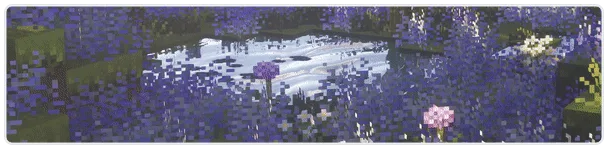</picture>

  <a href="https://ruu.by"><picture><source media="(prefers-color-scheme: dark)" srcset="assets/button-portfolio-dark.svg">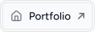</picture></a>
  <a href="https://rubylabs.design"><picture><source media="(prefers-color-scheme: dark)" srcset="assets/button-studio-dark.svg">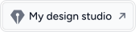</picture></a>
  <a href="https://dajia.lol"><picture><source media="(prefers-color-scheme: dark)" srcset="assets/button-dajia-dark.svg">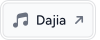</picture></a>
  <a href="mailto:florian@ruu.by"><picture><source media="(prefers-color-scheme: dark)" srcset="assets/button-mail-dark.svg">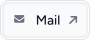</picture></a>

<h2><picture><source media="(prefers-color-scheme: dark)" srcset="assets/label-about-dark.svg"></picture></h2>

- Swiss interaction _and visual_ designer
- Check out my own design studio, [rubylabs](https://rubylabs.design)
- I also built [Dajia.lol](https://dajia.lol), a customizable Last.fm music profile card website
- I daily drive  Arch + 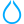 Hyprland and love customising everything

<h2><picture><source media="(prefers-color-scheme: dark)" srcset="assets/label-projects-dark.svg"></picture></h2>

<a href="https://dajia.lol"><picture><source media="(prefers-color-scheme: dark)" srcset="assets/card-dajia-showcase-dark.svg">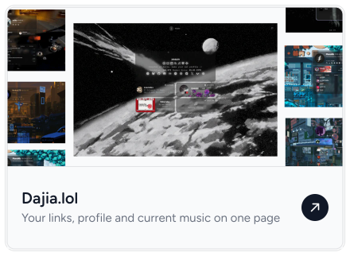</picture></a><a href="https://rubylabs.design"><picture><source media="(prefers-color-scheme: dark)" srcset="assets/card-rubylabs-dark.svg">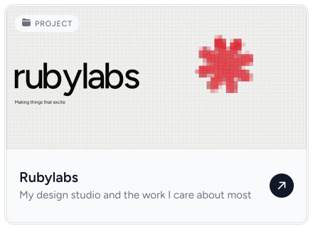</picture></a><a href="https://ruu.by"><picture><source media="(prefers-color-scheme: dark)" srcset="assets/card-portfolio-dark.svg">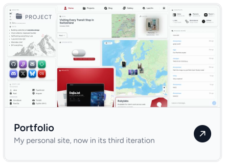</picture></a><a href="https://iconpacker.ruu.by"><picture><source media="(prefers-color-scheme: dark)" srcset="assets/card-iconpacker-dark.svg">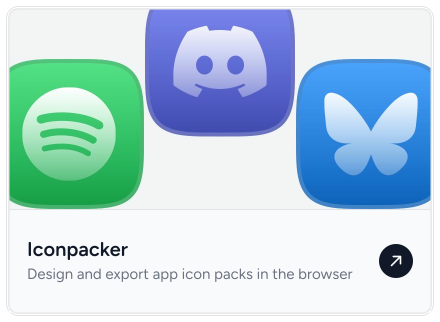</picture></a><a href="https://gh.ruu.by"><picture><source media="(prefers-color-scheme: dark)" srcset="assets/card-ghchart-dark.svg">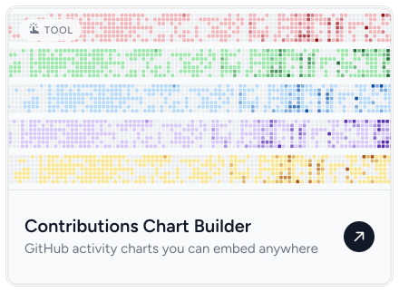</picture></a><a href="https://ruu.by/projects"><picture><source media="(prefers-color-scheme: dark)" srcset="assets/card-more-dark.svg">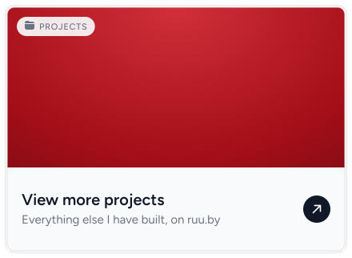</picture></a>

<h2><picture><source media="(prefers-color-scheme: dark)" srcset="assets/label-stats-dark.svg"></picture></h2>

